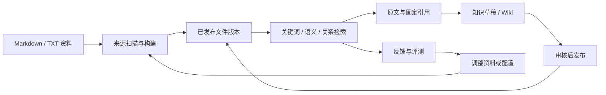

# XRAG

XRAG 把 Markdown/TXT 资料组织成可持续更新的知识库，提供关键词、语义和关系检索，保留可回读的文件版本，并支持知识草稿、Wiki、反馈评测与有界调查。工作台、CLI、HTTP 和 MCP 共用检索与任务能力；不配模型也能从文本检索开始使用。

当前版本为 [0.10.4](https://github.com/BlueSkyXN/XRAG/releases/tag/v0.10.4)，包含图片描述、单字关键词召回和 Qdrant 升级兼容修复。项目处于实验阶段，功能与验证边界统一见 [当前状态](docs/STATUS.md)。



## 快速开始

### 从源码运行

需要 Go 1.23+、C 编译器、带 FTS5 的 SQLite 开发库、make，以及构建工作台所需的 Node.js 22 和 npm。在项目根目录执行：

```bash
make web
bash demo.sh
```

浏览器打开 `http://127.0.0.1:8765`，输入终端显示的 API Key。`demo.sh` 编译两个 Go 程序，初始化 `.xrag/`，导入合成示例并排队构建 `demo` 库。等任务完成后搜索 `E203`；按 Ctrl+C 停止，资料保留。

`make web` 安装前端锁定依赖并生成内嵌资源，前端有改动后需重新执行。只运行 `make build` 或 `demo.sh` 不会构建前端；缺少产物时 `/` 返回 503，API 与 MCP 仍可运行。默认启动不下载模型或外部数据库。

### 使用发行包

从 [Releases](https://github.com/BlueSkyXN/XRAG/releases) 下载 Linux amd64 完整包，解压后执行 `bash run-linux.sh`。需要带 FTS5 的 libsqlite3；Git 来源需要 git。Linux 二进制的 GLIBC 下限以所下载附件及其构建检查为准，见 [开发与发布](docs/DEVELOPMENT.md)。

纯 Client 包提供 macOS arm64/amd64、Windows amd64、Linux arm64，不含 Server，也不需要 C/SQLite。附件可用同一 Release 的 `SHA256SUMS` 校验。

### 使用 Docker

```bash
docker run -d --name xrag -p 8765:8765 \
  -v xrag-data:/data ghcr.io/blueskyxn/xrag:0.10.4
docker exec xrag cat /data/xrag/admin.key
```

打开 `http://127.0.0.1:8765`，用取得的 Key 登录。首次初始化会导入并构建示例，数据保存在卷的 `/data/xrag`。使用宿主目录挂载时，目录须对容器 UID 1000 可写。

镜像提供版本、`sha-<短SHA>` 与 `main` 标签，不发布 `latest`。部署需固定版本或 digest。密码登录、环境变量与维护见 [日常管理](docs/PRODUCT_OPERATIONS.md)；Hugging Face 见 [Space 部署说明](deploy/hf/README.md)。

## 第一次查询

另开终端，在项目根目录保存连接并检索：

```bash
./bin/xrag profile add team --server http://127.0.0.1:8765 \
  --key-file "$PWD/.xrag/admin.key" --kb demo
./bin/xrag search keyword E203 --profile team
./bin/xrag +ask "日志丢失怎么排查" --profile team --trace
./bin/xrag files read --path manual/02-errors.md --kb demo --profile team
```

`search.keyword` 适合编号、关键词和完整计数；`+ask` 使用宽松词法召回，并按配置组合语义、图与重排，返回资料候选。需要多步调查与结论时使用 Research；固定步骤使用 Recipe。详见 [检索指南](docs/RETRIEVAL.md) 和 [调查与配方](docs/RESEARCH.md)。

直接读取本地目录可以跳过 Server：

```bash
./bin/xrag +ask "日志丢失怎么排查" --local ./examples/docs --kb demo
```

## 选择接入方式

| 方式 | 适用场景 | 数据与权限 |
|---|---|---|
| 工作台 | 查资料、管理来源、发布知识、评测与运维 | Server 的角色与知识库权限 |
| Client `server` | CLI、脚本与远程应用 | 通过 API Key 访问已发布资料 |
| Client `local` | 只读检索当前机器上的 MD/TXT 目录 | 本地文件权限；无服务端任务 |
| Client `direct` | 直接读取 XRAG 写入的 Qdrant/Neo4j | 使用后端身份与物理集合；见 [连接说明](docs/CONNECTIONS.md) |
| MCP | 给 Agent 提供检索、阅读与可选任务工具 | HTTP Bearer 或 stdio profile；见 [API 与 MCP](docs/API_MCP.md) |

```bash
./bin/xrag mcp --profile team --toolsets core,graph,files,utility,research
```

## 阅读文档

[文档总览](docs/README.md) 按使用场景组织全部指南：

| 目标 | 文档 |
|---|---|
| 理解组件、存储和发布流程 | [架构图解](docs/ARCHITECTURE.md) |
| 导入资料、持续更新、比较效果 | [来源与构建](docs/OPERATIONS.md) |
| 检索、范围、分页、统计和固定引用 | [检索指南](docs/RETRIEVAL.md) |
| 模型、专业后端与三种 Client | [连接与配置](docs/CONNECTIONS.md) |
| 草稿、Wiki、外部来源与写回 | [知识生命周期](docs/LIFECYCLE_AND_SOURCES.md) |
| 角色、登录、配置与维护 | [日常管理](docs/PRODUCT_OPERATIONS.md) |
| 备份、恢复和历史清理 | [数据恢复](docs/DATA_RECOVERY.md) · [历史维护](docs/HISTORY_MAINTENANCE.md) |
| 开发、检查、打包与发布 | [开发指南](docs/DEVELOPMENT.md) |
| 发布差异与当前限制 | [更新记录](docs/CHANGELOG.md) · [功能表](docs/FEATURE_MATRIX.md) · [当前状态](docs/STATUS.md) |

文档图使用 Markdown 中的 Mermaid 代码块。GitHub 等支持 Mermaid 的阅读器可直接呈现，其他阅读器可查看图的源码与配套文字。

## 许可

项目按 [GPL-3.0](LICENSE) 发布，说明见 [LICENSE_NOTICE.md](LICENSE_NOTICE.md)。
