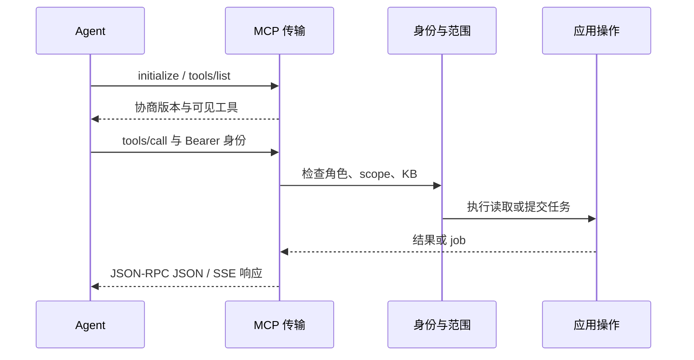

# HTTP、CLI 与 MCP 接入

多数读取动作共享 [contracts/registry.json](../contracts/registry.json) 的名称、路径和输入 Schema。管理、草稿与持久任务有独立处理器。图片描述提供专用 HTTP、CLI 与 MCP 入口，尚未发版，使用方式见 [IMAGE_DESCRIBE.md](IMAGE_DESCRIBE.md)。

## 身份与请求

HTTP API 使用 `Authorization: Bearer API_KEY` 与 `Content-Type: application/json`；工作台通过登录建立会话。MCP HTTP 只接受 Bearer，不能复用工作台 Cookie。API Key 的角色和 KB 范围由 Server 检查，见 [访问管理](PRODUCT_OPERATIONS.md)。

常规读取动作用 POST，示例请求体：

```json
{"kbs":["demo"],"q":"E203","limit":10,"trace":true}
```

发送到 `/v1/search/keyword`。CLI 对应：

```bash
./bin/xrag search keyword E203 --profile team --limit 10 --trace
./bin/xrag search keyword --profile team --data @request.json --dry-run
```

常规检索响应包含 `items`、`total`、`coverage`、`result_id`、`next_cursor` 等字段，定义见 [响应 Schema](../contracts/response.schema.json) 和 [检索指南](RETRIEVAL.md)。管理路由、任务、图片描述各返回自己的对象，不能统一按检索响应解码。失败读取 `error.code/message/retryable`；检索也应检查 `failure` 与 `coverage.execution_partial`。

## 读取动作映射

下表中的 HTTP 路径均为 POST。图和语义是否可用取决于所选模式与配置。

| 动作 / CLI | HTTP | MCP 工具 | 工具组 |
|---|---|---|---|
| `kb discover` | `/v1/discover` | `kb_discover` | core |
| `search keyword` | `/v1/search/keyword` | `search_keyword` | core |
| `search semantic` | `/v1/search/semantic` | `search_semantic` | core |
| `files tree` | `/v1/files/tree` | `files_tree` | files |
| `files grep` | `/v1/files/grep` | `files_grep` | files |
| `files read` | `/v1/files/read` | `files_read` | core |
| `graph entity` | `/v1/graph/entity` | `graph_entity` | graph |
| `graph neighbors` | `/v1/graph/neighbors` | `graph_neighbors` | core |
| `graph path` | `/v1/graph/path` | `graph_path` | graph |
| `graph chunks` | `/v1/graph/chunks` | `graph_chunks` | graph |
| `+ask` | `/v1/ask` | `ask` | core |
| `+context` | `/v1/context` | `context` | graph |
| `handle show` | `/v1/handles/describe` | `handle_describe` | utility |
| `results page` | `/v1/results/page` | `results_page` | core |
| `scope expand` | `/v1/scopes/expand` | `scope_expand` | utility |
| `search external` | `/v1/search/external` | `search_external` | external |

`image_describe` 属于 core 组，仅在 Server 接入时提供。HTTP MCP 和 Server profile 的 stdio 均使用单一 `kb` 与专用图片请求，返回 `{kb,description,images,usage}`，详见 [图片描述](IMAGE_DESCRIBE.md)。注册表有 17 项公共动作，可调用范围取决于模式、工具组、配置和权限。

## MCP 连接

stdio 使用已有 Server profile：

```bash
./bin/xrag mcp --profile team --toolsets core,graph,files,utility,research
```

在 Agent 客户端中把 `command` 设为 xrag 可执行文件的绝对路径，`args` 使用上面的参数。无稳定工作目录时，给 `--config` 传绝对路径。

HTTP 地址与请求头：

```text
http://127.0.0.1:8765/mcp?toolsets=core,graph,files,utility,research
Authorization: Bearer <your-key>
Accept: application/json, text/event-stream
MCP-Protocol-Version: 2025-11-25
```

HTTP 默认工具组为 `core,graph,files,utility,external`，stdio 默认为 `core,graph,files,utility`。增加 `write` 才公开 `knowledge_submit`、`feedback_submit`，需要 Contributor 或更高角色；增加 `research` 才公开 `research_submit`、`recipe_run`、`research_status`、`research_cancel`、`research_resume`。工具组选择不扩大调用者权限。



### 协议范围

| 项目 | 当前行为 |
|---|---|
| 版本 | 2025-11-25、2025-06-18、2025-03-26 |
| HTTP | POST `/mcp`；按 Accept 返回 JSON 或请求内 SSE |
| SSE | 心跳及最终 JSON-RPC 响应，非逐 Token 生成 |
| GET / DELETE | 405；无独立服务端推送流或协议会话删除 |
| 通知 | 202 空响应；支持匹配在途调用的取消通知 |
| stdio | 每行一个 JSON-RPC 对象，有限并发 |
| 输入与并发 | 单对象、最多 2 MiB；HTTP 128 个在途、stdio 8 个并发调用；单次最多 10 分钟 |
| 未实现 | MCP Tasks、sampling、subscriptions、会话事件重放及 2026 新线全部行为 |

相同身份的并发 request ID 必须唯一。断开请求流不会取消已接受的持久任务；使用 `research_cancel` 或 CLI `jobs cancel`。任务自身的 SSE 是另一个接口，见 [Research](RESEARCH.md)。

### resources 与 prompts

- `xrag://guide/retrieval`：静态检索指南。
- `xrag://catalog`：当前身份可见的 Discover。
- `xrag://refs/{ref}`：已返回引用的阅读模板，遵守原引用范围。
- `xrag_retrieve` prompt：接收 `question` 和可选 `kb`，给出工具选择说明。

本项目的协议探针可在已有本机服务上运行：

```bash
python3 scripts/mcp_probe.py --url http://127.0.0.1:8765/mcp \
  --key-file .xrag/admin.key --report /tmp/xrag-mcp-probe.json
```

## 可选外部 OAuth 资源服务

Server 可接受外部授权服务器签发的 access token。复制 [mcp-auth.json](../examples/mcp-auth.json)，配置后启动：

```bash
./bin/xrag-server serve --data .xrag --mcp-auth /absolute/path/mcp-auth.json
```

| 配置 | 含义 |
|---|---|
| `resource` | 客户端看到的完整 MCP URL，用于 audience 匹配 |
| `issuer` | 外部授权服务器标识 |
| `introspection_endpoint` | RFC 7662 端点；POST form 与 Client Basic 身份 |
| `client_secret_ref` | Server 可读的 env/file 引用 |
| `subjects` | `sub` 到 reader/contributor/maintainer 及 KB 的映射 |

每次 OAuth 请求执行 introspection，校验 active、sub、iss、aud、exp、scope 以及可选 nbf。端点需 HTTPS；本机测试仅可显式开启数值环回 HTTP。元数据位于 `/.well-known/oauth-protected-resource/mcp` 与根元数据路径，challenge 提供发现信息。

`xrag:read` 为基础 scope，`xrag:write` 与 `xrag:research` 分别允许对应工具组，并继续与本地角色/KB 取交集。OAuth 只用于 `/mcp`；`/v1/*` 与普通 CLI 继续用 XRAG Key。XRAG 不提供授权页面、签发、登录换码或刷新令牌客户端，须由外部身份系统完成。

## 管理和任务接口

管理结构与入口索引见 [contracts/management/README.md](../contracts/management/README.md)。常用任务入口：

| HTTP | 用途 |
|---|---|
| POST `/v1/research` | 提交 Research |
| POST `/v1/recipes/run` | 提交 Recipe |
| POST `/v1/tasks/status` | 按 ID 读取调用者范围内任务 |
| POST `/v1/tasks/cancel` | 请求取消 |
| POST `/v1/tasks/resume` | 明确续跑检查点 |
| GET `/v1/tasks/events?id=...` | 当前任务快照 SSE |

提交使用 `Idempotency-Key` 时，相同请求沿用同一任务；修改 payload 后重用同键会冲突。入队成功与任务成功需分别检查。
