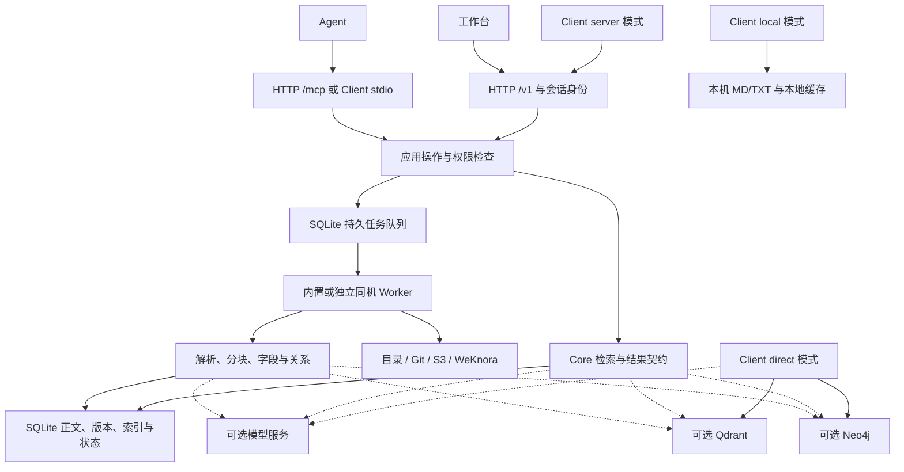
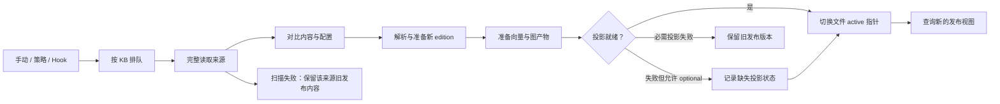
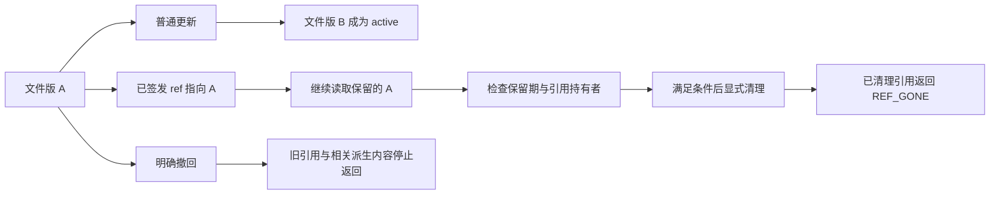

# 架构图解

XRAG 由 `xrag-server` 和 `xrag` 两个 Go 程序组成。Server 管理资料、权限与持久任务；Client 根据 profile 访问 Server、本地目录或外部数据库。工作台是内嵌在 Server 中的 React 前端。

## 组件与数据路径

实线表示主要调用或存取方向，虚线表示按配置启用的外部能力。`local`、`direct` 也复用 Core，但不经过 Server 的权限、发布状态与任务系统。

| 模块 | 职责 | 代码入口 |
|---|---|---|
| Core | 分词、检索组合、图遍历、范围、引用、结果与计数 | [core/](../core/) |
| 协议契约 | 动作名、HTTP/CLI/MCP 映射、输入输出结构 | [contracts/](../contracts/) |
| HTTP / MCP | 认证、授权、管理路由、会话、传输 | [internal/server/](../internal/server/)、[protocols/mcp/](../protocols/mcp/) |
| 构建与任务 | 扫描、解析、模型投影、发布、Wiki、调查 | [internal/build/](../internal/build/)、[research/](../research/) |
| 持久层 | SQLite、版本目录、索引、任务、预算与恢复状态 | [internal/store/](../internal/store/) |
| 适配器 | 模型、专业数据库、解析器、local/direct | [adapters/](../adapters/) |
| CLI / 工作台 | 用户交互与远程调用 | [internal/cli/](../internal/cli/)、[webapp/](../webapp/) |

## 从来源到已发布版本

构建按 KB 互斥执行，来源读取完成后才根据缺席文件执行移除。普通增量与完整构建以文件为发布单位；`vectors_only` 从已发布内容准备新向量后统一提交选定库的结果。配置允许 optional 投影时，正文可在记录缺失投影状态的情况下发布。

外部投影写入先于 SQLite 发布。Server 用 active edition 和范围过滤结果；direct 直接观察后端数据，可能读到 staging 或 retired 内容。因此 direct 凭据与集合使用者需要自己协调访问和保留期。

## 哪些数据存在哪里

| 存储 | 主要内容 |
|---|---|
| SQLite | 原文、文件物化版、块、FTS 索引、已存数值向量和关系支撑、知识、任务、配置引用、反馈、评测、预算记录 |
| Qdrant（可选） | XRAG 物理集合中的块正文、向量、词法稀疏向量与元数据；descriptor 标记资料域、模型和集合 |
| Neo4j（可选） | 实体、关系支撑、块标识与出处摘录；完整原文由 SQLite/Qdrant 提供 |
| Server 数据目录 | `xrag.sqlite`、初始 `admin.key`、来源副本/缓存、备份与锁文件等 |
| Client 配置目录 | `client.json` 与按 profile 隔离的查询缓存；默认 `~/.xrag/` |
| 原来源与配置文件 | 目录、Git、对象存储、外部 JSON、环境变量或密钥文件；需自行保管 |

产品版本、响应 `schema_version` 和磁盘 `store_schema` 分别承担发行、响应格式和磁盘兼容判断。当前值与升级边界见 [状态](STATUS.md)。

## 固定引用与生命周期

`ref` 固定资料域、KB、路径及物化版/块身份。`path` 阅读选择当前发布文件，`ref` 阅读选择签发时版本。结果分页缓存保存有序身份，后续页按原版本补取正文，不重新检索。

知识修订、反馈、题集、有效结果与任务等会持有引用，影响可清理版本。明确撤回优先于历史保留：数据仍在备份或历史存储里，也不能继续通过应用读取已撤回内容。详细操作见 [检索](RETRIEVAL.md)、[恢复](DATA_RECOVERY.md) 和 [维护](HISTORY_MAINTENANCE.md)。

## 运行边界

每个数据目录只运行一个 API Server，可以使用内置 Worker 或独立的同机 Worker。进程通过 SQLite 任务与本机锁/租约协调；当前没有多机共享 SQLite、分布式 direct 读租约或跨数据库原子事务。

模型、Qdrant、Neo4j 和外部来源均按配置接入。配置加载本身不下载服务或发起模型调用；构建、查询、Wiki、Research 等具体操作才使用相关能力。真实外部服务的验证范围集中在 [STATUS.md](STATUS.md)。
