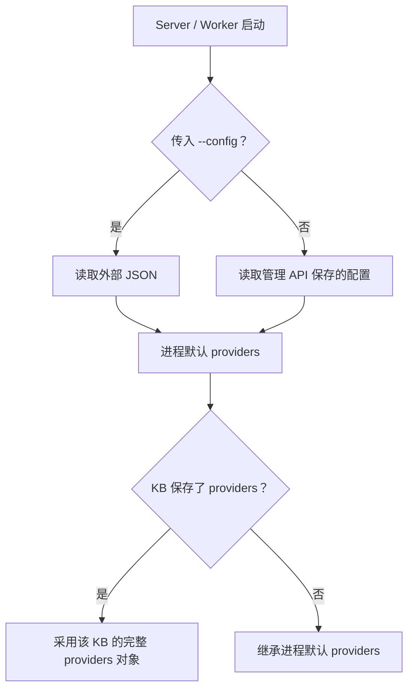

# 连接、配置与 Client 模式

基础关键词、原文、显式关系与 Recipe 可在无模型环境使用。需要语义、Wiki、Research 或重排时，再配置对应服务。模板均在 [examples/](../examples/)，外部服务验证范围见 [STATUS.md](STATUS.md)。

## 配置来源与生效方式



服务级配置保存后，停止并重启 Server 和所有 Worker，检查 `active`。外部 `--config` 优先，Web 中的服务级配置只读。`demo.sh` / `run-linux.sh` 通过 `XRAG_DEMO_CONFIG` 传入此文件；通用容器入口未读取这个变量，容器默认使用数据库保存的配置。

按库设置通过 `kb settings` 管理，影响后续操作；不要在已有任务执行中切换其模型配置。设置了 KB providers 时，采用完整对象，不逐字段混合默认服务。改变模型身份、修订、前缀或维度后还需显式构建。

```bash
./bin/xrag settings show --profile team
./bin/xrag settings save --profile team --data @examples/settings.chat.json
./bin/xrag kb settings demo --profile team
./bin/xrag kb settings demo --profile team --data @examples/kb-models.json
```

先读取 `revision`，再把对应模板的 `expected_revision` 改为当前值。冲突返回 `VERSION_CONFLICT`，重新读取后决定如何合并。

## 模型服务

| 配置 | 接口 | 用途 |
|---|---|---|
| `embedding` | API 根追加 `/embeddings` | 构建文档向量与语义查询；需 model、dimension、模型修订声明 |
| `chat` | API 根追加 `/chat/completions` | Wiki、Research、可选图抽取；图片描述另需模型支持视觉 |
| `rerank` | API 根追加 `/rerank` | 请求 `{model,query,documents,top_n}`，结果含 index 与 relevance_score |

Embedding 最小示例：

```json
{
  "embedding": {
    "url": "https://models.example/v1",
    "key": "env:EMBED_API_KEY",
    "model": "your-embedding-model",
    "dimension": 1024,
    "revision": "declared-r1"
  }
}
```

将模板保存到自己的配置文件，准备执行端的环境变量，再启动：

```bash
XRAG_DEMO_CONFIG="$PWD/providers.json" bash demo.sh
```

凭据只用 `env:NAME` 或 `file:/absolute/path`；引用在真正调用服务的机器上解析。Server/Worker 与 direct Client 要分别准备它们需要的引用。保存配置不解析密钥、不发探测，也不证明端点当前可达。

Embedding 文档输入包含标题、标题链与正文，query 可配置独立前缀；适配器检查维度、索引顺序和有限非零向量。默认构建有调用次数上限；需要费用控制时配置 KB budget 和 rates，见 [日常管理](PRODUCT_OPERATIONS.md)。

## Qdrant 与 Neo4j

```json
{
  "qdrant": {"url":"http://127.0.0.1:6333","key":"env:QDRANT_API_KEY"},
  "neo4j": {"url":"http://127.0.0.1:7474","database":"neo4j","user":"neo4j","password":"env:NEO4J_PASSWORD"}
}
```

这是添加到 providers 的片段：Server 配置 Qdrant 时还必须有 Embedding。Neo4j 可独立存放显式关系；使用 HTTP Query API v2 `/db/{database}/query/v2`，不是 Bolt 地址。匿名本机 Qdrant 可以省略 key。

Qdrant 使用含资料域、KB 与模型身份的物理集合，并在 `xrag_demo_meta` 中保存 descriptor。新投影包含名为 `xrag_terms` 的稀疏词法向量，Schema 为 `xrag-terms-fnv1a32-bm25-v1`。不要由其他应用修改 XRAG 集合布局。Neo4j 存关系支撑与块身份；全文由 SQLite/Qdrant 提供。

## server、local、direct

| 模式 | 资料读取 | 可用功能与限制 |
|---|---|---|
| server | HTTP 访问 Server | 发布视图、角色/KB 权限、持久任务、草稿、管理功能 |
| local | 当前机器目录 | 只读 MD/TXT、关键词与问句召回、原文、文件树；无模型/服务端发布任务 |
| direct | 固定 Qdrant/Neo4j binding | 关键词、稀疏词法/语义候选、图与按引用读取；无 Server 发布、撤回与角色语义 |

客户端配置默认是 `~/.xrag/client.json`。用 `--config` 指向另一份 Client 配置时，该参数不是 Server 的 providers 文件。

```bash
./bin/xrag profile add team --server http://127.0.0.1:8765 \
  --key-file "$PWD/.xrag/admin.key" --kb demo
./bin/xrag files tree --local ./examples/docs --kb demo
./bin/xrag +ask "日志丢失怎么排查" --local ./examples/docs --kb demo
```

local 每次扫描最多 20,000 个支持文件、单文件 5 MiB、合计 50 MiB。Server 每来源的上限另为 5,000 文件、单文件 5 MiB、合计 64 MiB。

### 设置 direct

复制 [client.direct.json](../examples/client.direct.json)，填入 XRAG 实际写出的 `physical_collection`、后端地址与对应 Embedding 身份。多库参考 [client-multi.json](../examples/client-multi.json)，各 binding 须属于相同资料域。

```bash
./bin/xrag +ask "日志丢失怎么排查" --config ./client.direct.json --profile direct --kb demo
./bin/xrag search semantic 日志 --config ./client.direct.json --profile direct --kb demo
./bin/xrag graph neighbors --name 设备A --config ./client.direct.json --profile direct --kb demo
```

direct 使用后端凭据。它可看到后端当时的 staging/retired 数据；没有完整文件树、grep 或按 path 读取整文件的保证。只有 Neo4j 的 binding 可返回图与标识，缺正文时 `text_available=false`。

简单 keyword/semantic/ask 可使用原生候选与按页取正文；`within`、复杂过滤或组合会转入有界元数据路径，上限 200,000 点。只匹配指定物理集合的资料域与模型身份。

### 旧集合启用稀疏词法

主线 Server 的语义查询按文件版本登记的物理集合读取，支持旧集合与新集合并存；启用 direct 稀疏词法仍需以下构建与 Client 配置更新。

出现“集合缺少稀疏词法索引，需要重建”时：

1. 在 Server 确认该库的模型配置与预算。
2. 执行 `./bin/xrag build run demo --profile team --mode vectors_only --wait`，或按需要完整构建。此操作可能调用 Embedding。
3. 从新 descriptor 取得实际物理集合名，更新 direct 配置并验证 keyword、ask、semantic 与 ref 阅读。
4. 旧集合继续保留；清理另按 [历史维护](HISTORY_MAINTENANCE.md) 的保留与引用条件执行。

## 插件与外部检索

解析器/抽取器命令由启动文件登记，按 KB 选择插件 ID。默认轻量解析不需 Python；CommonMark 插件使用 markdown-it-py 与 PyYAML，安装步骤见 [开发指南](DEVELOPMENT.md)。JSONL 插件按调用启动，受限时与输出大小约束，当前无沙箱、进程池或动态安装市场。

`providers.external[]` 连接显式登记的 XRAG peer，通过其 `/v1/ask` 与 `/v1/files/read` 检索和阅读。WeKnora 走解析文本导入，步骤见 [外部来源](LIFECYCLE_AND_SOURCES.md)。两条路线的来源与权限含义不同。

专业后端的实际联调步骤见 [LIVE_INTEGRATION.md](LIVE_INTEGRATION.md)。
