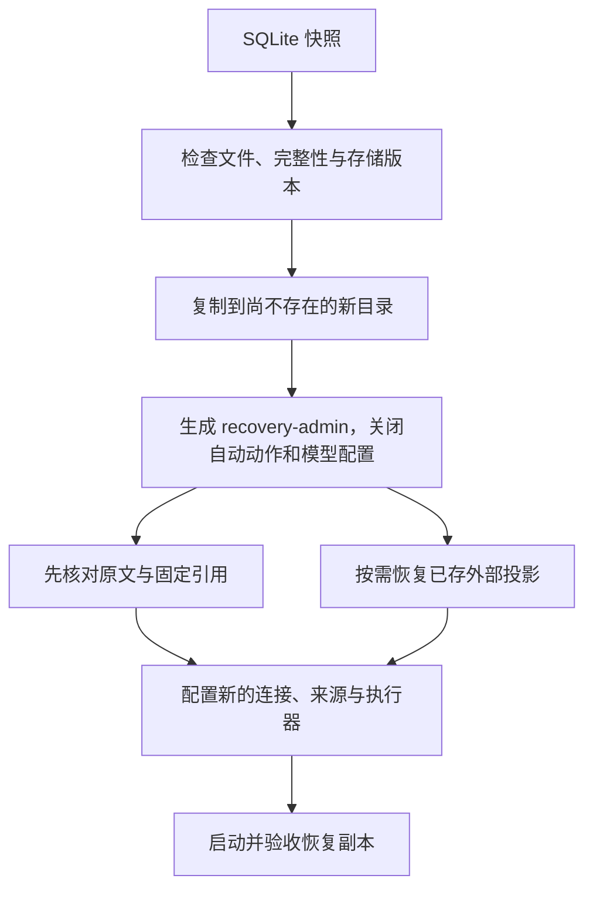

# 数据导出、备份与恢复

先按恢复目标选择产物。以下命令假定已有 `team` profile；管理快照和恢复需管理员操作。版本与存储兼容范围见 [STATUS.md](STATUS.md)。

## 选择备份范围

| 产物 | 包含 | 还需独立保存 |
|---|---|---|
| 已发布资料 ZIP | 当前 MD/TXT、来源、edition、hash、ref 清单 | 草稿、历史、任务、Key、模型/后端状态 |
| SQLite 快照 | 入库正文、历史、知识修订、已存向量/关系、任务、配置引用、反馈、评测和 Key 摘要 | 来源目录、明文 Key、外部配置、env/file 秘密值、外部数据库实例 |
| 停机完整数据目录副本 | 数据目录内全部文件 | 目录外来源/配置、环境变量和远端数据库 |
| 外部数据库备份 | 由供应商工具决定 | 与 XRAG 发布状态的一致性需部署者协调 |

快照可能含历史和撤回内容，仅管理员可获取；已经下载的旧备份不受在线撤回控制。SQLite 快照固定数据库状态，来源与外部库需单独协调。

## 导出与创建快照

```bash
# Maintainer/Admin：可读资料交接，输出文件必须不存在
./bin/xrag kb export demo --profile team --out published.zip
# Admin：可恢复的数据库快照
./bin/xrag backup create --profile team --confirm
./bin/xrag backup list --profile team
./bin/xrag backup download BACKUP_ID --profile team --out snapshot.sqlite
```

资料 ZIP 最多 10,000 文件、64 MiB 正文，超限失败。快照在 Server 的 `backups/` 下生成并登记大小、SHA-256、时间，最多登记 20 份。手动快照不会被自动备份计划轮转。

本机命令 `./bin/xrag-server backup --data .xrag --out NEW_FILE.sqlite` 也可创建快照，但不进入 Web 备份列表。创建/下载会占用 I/O 与数据库连接；大库在维护时段执行并调整客户端超时。自动计划见 [历史维护](HISTORY_MAINTENANCE.md)。

## 恢复到新目录



```bash
./bin/xrag-server restore --from snapshot.sqlite \
  --data /absolute/parent/restored-xrag --confirm
./bin/xrag-server serve --data /absolute/parent/restored-xrag \
  --listen 127.0.0.1:8766 --workers off
```

父目录须已存在，目标目录须不存在，输入最大 2 GiB 且符合当前存储布局。程序检查 SQLite 与 XRAG 表；失败只清理本次新建目标，不覆盖原库或输入快照。

恢复会保留 origin、KB、文件/edition、引用、知识与记录，同时：

- 停用旧 Key，生成 `recovery-admin`，明文写入新目录 `admin.key`。
- 关闭来源扫描、Hook、维护计划等自动动作，清除保存的模型配置。
- 将未完成任务置为失败，未知已发调用保留 outcome_unknown。
- 清除临时范围、分页缓存和旧备份登记，保留静态历史引用。
- 写入 `RESTORE_INFO.json`，使启动脚本和容器跳过自动构建。

用恢复目录的 Key 登录，先核对原文和旧引用，再配置服务。来源路径可能在新机器不存在或指向其他内容，检查后才能启用构建。新旧副本保留相同 origin，应使用不同 profile、端口和明确的部署名称。

## 恢复外部投影

SQLite 保存过的数值向量与关系支撑可写入专用 Qdrant/Neo4j 恢复目标，无需重新调用模型：

```bash
# 编辑模板中的专用目标，预览仅读取恢复副本
./bin/xrag-server recover-projections --data /absolute/parent/restored-xrag \
  --targets /absolute/path/recovery-targets.json
# 确认目标与计划后执行
./bin/xrag-server recover-projections --data /absolute/parent/restored-xrag \
  --targets /absolute/path/recovery-targets.json --confirm
```

模板为 [recovery-targets.json](../examples/recovery-targets.json)。执行前停止该副本的 Server/Worker。仅带恢复标记的副本可执行；目标 Qdrant 物理集合须不存在，Neo4j 本 authority 下不能已有节点，恢复时应禁止其他写者。

程序先登记恢复身份，再按确定的版身份写数据并保存进度。失败后副本不能提供服务，应以同一目标继续；完成后重复执行返回已有结果。最多处理 100,000 个可读物化版，排除撤回和未发布中间版。

这里只恢复 SQLite 已存的 XRAG 投影，缺失产物、模型权重、其他应用数据仍需原来源或供应商备份。恢复后查询还需要匹配的模型身份和凭据。真实专业后端恢复验证范围见 [STATUS.md](STATUS.md)。

## 升级和回退

当前磁盘标记为 `demo9`，不提供更早 Demo 存储的自动迁移。程序发行版本可以变化而保留此标记，升级前仍需阅读对应更新记录并保留停机副本。

同目录升级保留现有身份和策略；restore 创建隔离副本并关闭自动动作。需要原样回退时，使用升级前的完整停机备份与原程序版本。恢复、配置重启或换镜像都不代替实际的引用、检索与任务验收。
