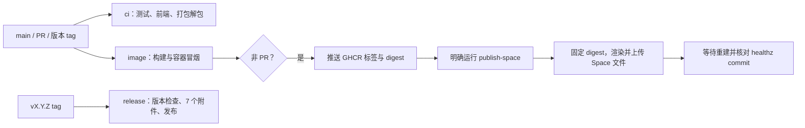

# 开发、验证与发布

代码模块关系见 [ARCHITECTURE.md](ARCHITECTURE.md)。本指南从仓库根目录执行命令，构建输出和测试数据使用忽略目录或临时目录。

## 环境与构建

| 场景 | 依赖 |
|---|---|
| Server | Go 1.23+、C 编译器、系统 SQLite 开发库且启用 FTS5、make |
| Client | Go 1.23+，可 `CGO_ENABLED=0` |
| 工作台 | Node.js 22、npm；React/Tailwind/Radix/Vite |
| CommonMark 插件/部分测试 | Python3、`plugins/commonmark/requirements.txt` |
| Schema 检查 | Python jsonschema |
| 浏览器自动化检查 | Playwright/Chromium；`XRAG_CHROMIUM` 可指定浏览器 |

```bash
make web
make build
```

`make web` 执行 `npm ci` 与前端编译，产物在 `internal/server/web/dist/`；Go 编译时用 embed 打包。修改前端后，需先重建前端再重建 Server。`make build` 生成 `bin/xrag-server` 与 `bin/xrag`，并将当前 Git SHA 写入 `core.Commit`。

仅开发前端时：

```bash
make web-dev
```

Vite 在 5173 提供页面，`/v1` 代理到 8765；需另行运行 Server。只需 API 时可跳过前端构建；缺少产物的 `/` 返回 503。Go 测试注入测试资源，不要求 Node。

## 按改动选择检查

```bash
make test
make race
make vet
python3 scripts/check_management.py
python3 -m unittest discover -s scripts -p 'test_*.py'
```

需要 CommonMark 测试时先安装对应依赖：

```bash
python3 -m pip install -r plugins/commonmark/requirements.txt
```

前端/部署或打包改动再做：

```bash
make web
make build
python3 scripts/smoke_workbench.py
bash scripts/static-check.sh
```

浏览器验收入口为 `scripts/smoke_demo9.py --browser` 和 `scripts/smoke_workbench.py --browser`。更早批次脚本的非浏览器检查仍用于回归，Demo.8 及以前的 `--browser` 面向已移除的经典界面。脚本编号表示加入批次，运行的程序和数据是当前版本与新临时库。

文档改动重点核对路径/链接、命令参数、JSON 和 Mermaid，运行涉及的无外部副作用示例即可。模型、发布、部署、删除与外部写入示例需在明确选定的测试目标上执行。

## 可复现语料与检索基线

```bash
python3 scripts/gen_corpus.py --docs 1000 --seed 20261016 --out /tmp/xrag-corpus
python3 scripts/corpus_eval.py --docs 1000 10000 --seed 20261016 \
  --report /tmp/xrag-corpus-eval.json
```

生成器的输出目录须是新目录。评测使用 `bin/` 中程序，创建临时库，记录构建耗时、SQLite 大小、命中、延迟、精确计数和实际失败阶段。Server 大语料按来源上限拆分；`--server-only` 可跳过 local 并在报告中标记。

`direct_recall_eval.py` 需要指定 Qdrant，会写独立测试集合；先检查其 `--help`、服务和清理范围。该基线使用确定性向量/协议 fixture 时，应按受控模型结果解释，真实模型联调另见 [LIVE_INTEGRATION.md](LIVE_INTEGRATION.md)。

历史资源实验保留在 [RESOURCE_PROBE.md](RESOURCE_PROBE.md) 和 [RESOURCE_PROBE7.md](RESOURCE_PROBE7.md)，其数值只对应当时样本与环境。

## 打包

```bash
# 非 Linux 平台可仅生成源码
python3 scripts/package.py --out /tmp/xrag-release --source-only
# Linux amd64 构建环境生成完整包
python3 scripts/package.py --out /tmp/xrag-release
python3 scripts/package_clients.py --out /tmp/xrag-release
```

`package.py` 要求工作区干净，包括未忽略的未跟踪文件；从 Git 跟踪清单生成源码，已跟踪文件被过滤规则遗漏会失败。完整 Linux 包核对 ELF/Go 平台、程序路径、编译提交与干净状态。Client 包为 macOS arm64/amd64、Windows amd64、Linux arm64；独立 Client 不含 Server。

`check_release.py --source SOURCE.zip --linux LINUX.tar.gz` 在临时目录解包并检查构建、测试、服务与工作台。源码、Linux 与 Client 包名含产品版本。发行共 6 个压缩包与 `SHA256SUMS`，合计 7 个附件。

### Linux GLIBC 要求

当前 [主线 CI](https://github.com/BlueSkyXN/XRAG/actions/runs/38907271155) 的 Linux amd64 二进制检查结果为 `Required GLIBC: 2.34`。release/ci 使用 Ubuntu 24.04 runner，并拒绝最大 GLIBC 符号要求高于 2.35 的构建。自定义构建或后续版本以目标二进制为准，可在 Linux 检查：

```bash
objdump -T bin/xrag-server | sed -n 's/.*(GLIBC_\([0-9.]*\)).*/\1/p' | sort -Vu | tail -1
```

不要把容器内部的 GLIBC 环境和下载包的宿主系统要求混用。

## CI、镜像和 HF 发布



- [ci.yml](../.github/workflows/ci.yml)：Go/Python、前端、工作台 HTTP 契约、静态检查、包解压运行。
- [image.yml](../.github/workflows/image.yml)：镜像构建、容器登录/检索/Git、HF 包装层、digest 提交检查；PR 不推镜像。
- [release.yml](../.github/workflows/release.yml)：检查 tag 与版本一致、提交属于 main、Release 不存在；构建并上传 7 附件后发布。
- [publish-space.yml](../.github/workflows/publish-space.yml)：从 main 手动执行，指定目标 Space/digest，等待并核对线上 commit。
- [corpus-eval.yml](../.github/workflows/corpus-eval.yml)、[direct-recall.yml](../.github/workflows/direct-recall.yml)：可选语料和直连基线。

GHCR 使用 `sha-<短SHA>`、分支/版本标签，不发布 latest。HF Rebuild 重建已固定的 digest；更新必须重新部署。发版、推镜像、HF 部署与业务验收是独立步骤，具体操作见 [HF 部署](../deploy/hf/README.md)。

## 文档维护

当前使用说明放专题指南，版本差异写 CHANGELOG，证据范围写 STATUS，历史批次保留原记录并标注归档。`examples/docs/` 是测试语料，修改会影响检索基线；`skills/` 是 Agent 工作流，需按其自身指令用途审查。

新增图用 Markdown `mermaid` 围栏，节点采用简单 ID 与引号包围的中文标签；不嵌入 HTML，不导出 SVG。图旁保留操作含义，阅读器不支持 Mermaid 时仍可理解。文档路径采用仓库相对链接，运行配置和真实凭据留在忽略目录。
