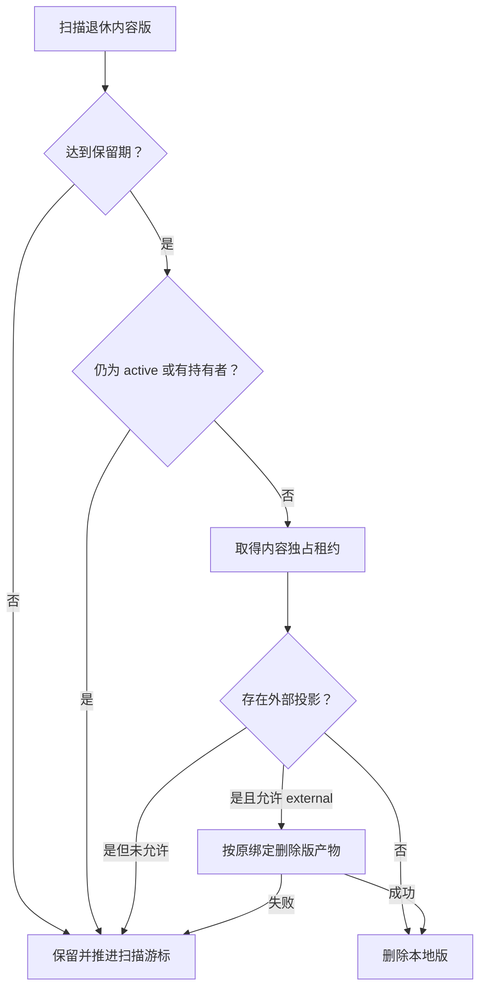

# 备份计划与历史维护

维护分为缓存、操作记录、历史内容版和退休向量集合四层。先选择目标、预览候选，并确认备份和引用保留要求。当前发布内容与有效持有者会保护相应版本。

## 选择操作

| 目标 | 入口 | 执行方式 |
|---|---|---|
| 过期结果、handle、查询摘要 | `maintenance preview / clean` | 在线显式清理 |
| 自动快照、任务/调用明细轮转 | `maintenance policy / records / run` | Worker 分批执行 |
| 已退休且无人持有的内容版 | `maintenance content / run` | 在线批次，取得内容独占租约 |
| 同类历史的停机整理 | `xrag-server prune` | 离线预览/确认，可显式清理外部版产物 |
| 已登记且空置的退休 Qdrant 集合 | `xrag-server vector-gc` | 离线单独确认 |

清理不执行自动 VACUUM，不保证物理文件立即缩小，也不擦除已下载备份。删除后读取未受保护的旧 ref 可能返回 `REF_GONE`。

## 自动计划与记录轮转

```bash
./bin/xrag maintenance policy --profile team
# 先更新模板 expected_revision 与需要启用的字段
./bin/xrag maintenance policy --profile team --data @examples/maintenance-policy.json
./bin/xrag maintenance records --profile team
./bin/xrag maintenance runs --profile team
```

| 字段 | 默认与范围 |
|---|---|
| `enabled` | false，总开关 |
| `backup_every_seconds` / `records_every_seconds` | 0 关闭；启用为 60–604800 秒 |
| `backup_keep` | 7，范围 1–15；只轮转维护流程创建的快照 |
| `records_keep_days` | 30，范围 1–36500 |
| `batch_size` | 200，范围 1–1000；内容版扫描每批另限 100 |
| `content_every_seconds` | 0；启用为 60–604800 秒 |
| `content_keep_days` | 30，按版本退休时间计算 |
| `content_external` | false，需明确允许才清理外部版产物 |

API-only 只保存策略和排队，内置或独立 Worker 执行。单次维护限时四分钟，租约最长十分钟。新自动快照成功后才删除超额的维护快照，手动快照保留；登记总数仍限 20，手动快照占满会使自动备份失败。

操作记录清理包括已结束任务详情、构建详情、触发记录、已结算模型调用。已结算用量先归并汇总；sent/outcome_unknown/usage_unknown/cost_unknown 保留。精简任务仍保留身份与幂等关系，过期请求返回 `JOB_EXPIRED`。

关闭计划取消尚未开始的自动任务，正在执行和显式提交的一次性任务需单独处理。

## 在线内容版清理

```bash
./bin/xrag maintenance content --profile team
./bin/xrag maintenance run --profile team \
  --data '{"content":true,"confirm":true}' --confirm
./bin/xrag maintenance runs --profile team
```



普通查询、建设和任务持共享租约，清理等待已有操作完成，新的内容操作可能等待。它只协调同机且遵守该数据目录租约的进程，不能感知 direct 客户端持有的外部版本。

当前 active、知识修订、反馈、题集、任务、有效结果/范围及保留期内的版本均受保护。扫描游标持续推进，避免总停在首批受保护版本。外部删除失败保留本地状态，不能通过清空配置绕过外部依赖。

## 离线 prune

停止该资料域所有 Server 和 Worker，备份后预览：

```bash
./bin/xrag-server prune --data /absolute/path/to/data --keep-days 30
# 包含已登记外部版产物时，显式选择外部清理并传原运行配置
./bin/xrag-server prune --data /absolute/path/to/data \
  --config /absolute/path/providers.json --external --keep-days 30
```

确认候选后，对选定命令增加 `--confirm` 执行。keep-days 为 1–36500；按退休时间计算。持有者数量/内容超限、存在无法解释的记录或待执行任务时停止。`--drop-model-cache` 另删除可重建模型缓存，后续可能重新收费调用。

运行锁必须覆盖所有同目录进程；旧程序或不遵守本机锁的外部写者需人为停止。外部版产物先清理，再删除本地版；跨系统操作失败可能需要继续完成远端步骤。

## 退休向量集合

先用内容版清理解除旧 edition 持有，再预览集合：

```bash
./bin/xrag-server vector-gc --data /absolute/path/to/data \
  --config /absolute/path/providers.json --keep-days 30
```

确认后增加 `--confirm`。默认预览只读取本地登记，不连接 Qdrant。执行需要同时满足：无 active/历史版持有、当前默认/KB 模型不再选择它、退休保留期已到、没有 queued/running 构建、无别名、descriptor 身份匹配且远端精确点数为 0。

只删除本资料域登记的空集合，不发现或清理未知孤儿集合。执行前需协调 direct 使用者停止读取该退休集合。备份和模型投影恢复见 [DATA_RECOVERY.md](DATA_RECOVERY.md)。
