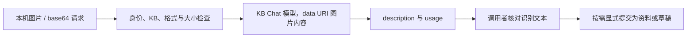

# 图片描述（main 未发布）

`image.describe` 使用所选知识库的 Chat 模型识别图片，返回文本描述与上游 usage。功能已合入 `main`，尚未包含在 `v0.10.3` Release 中。需要支持 OpenAI Chat Completions 图片 content parts 的视觉模型。

图片描述不会存为来源、知识条目或向量索引。需要把识别结果纳入知识库时，先核对文本，再按普通 MD/TXT 上传或知识草稿流程提交。



## CLI

使用 Server profile；省略 `--kb` 时取 profile 的唯一默认库，多库 profile 需明确选择目标：

```bash
./bin/xrag profile add vision --server http://127.0.0.1:8765 \
  --key-file "$PWD/.xrag/admin.key" --kb demo
./bin/xrag image describe --profile vision \
  --kb demo --images ./panel.png "图中显示了什么错误码和提示文字？"
./bin/xrag image describe --profile vision \
  --images ./front.jpg,./back.jpg "分别描述两张图片的可见内容。"
```

模型配置使用该 KB 的 `chat`。也可用 `--data @request.json` 提供下方完整 JSON；显式 `--kb` 优先于 JSON 的 `kb`。`--dry-run` 读取文件并校验数量、格式、base64、大小与 prompt，显示目标库、图片数量和端点；权限、模型配置和预算由实际请求时的 Server 检查。

## HTTP

`POST /v1/describe` 使用 Bearer API Key，JSON 格式：

```json
{
  "kb": "demo",
  "prompt": "描述图片中可读的文字",
  "images": [
    {"mime":"image/png","data_base64":"REPLACE_WITH_BASE64_IMAGE_BYTES"}
  ]
}
```

`data_base64` 填图片原字节的标准 base64，不带 `data:` 前缀；Server 构造 data URI 发送到模型。请求不接受图片 URL。响应为专用对象 `{kb,description,images,usage}`，不使用常规检索响应的 items/total。

| 限制 | 当前值 |
|---|---|
| 数量 | 1–4 张 |
| MIME | image/png、image/jpeg、image/webp、image/gif |
| 单张 base64 | 最多 700,000 字符，约对应 513 KiB 原始图片 |
| 解码后合计 | 另设 8 MiB 上限；单图 base64 限制更早生效 |
| prompt | 非空，服务端最多 4,000 UTF-8 字节 |
| HTTP body | `/v1/describe` 最多 12 MiB；MCP 单条 JSON-RPC 消息最多 2 MiB |
| 上游请求 | Chat Completions，temperature=0、max_tokens=1800、detail=auto |

CLI 文件预检查采用 525,000 字节上限，对应 700,000 个 base64 字符。超限需先压缩图片；HTTP JSON 与 CLI `--data` 同样受单图 base64 限制。

## MCP 与用量

Server 的 HTTP MCP 和 Server profile 的 stdio 均提供 core 组的 `image_describe`。工具参数与上述 HTTP JSON 相同，输出 Schema 为 [image-response.schema.json](../contracts/image-response.schema.json)。local/direct 不提供该工具。MCP 整条消息限 2 MiB，多图请求超过该限制时可减少图片或改用专用 HTTP 接口。

调用使用目标 KB 的 Chat 配置和预算：发送前预留，超限返回 `BUDGET_EXCEEDED`，设定金额限额却缺少价格时返回 `BUDGET_PRICE_MISSING`。预留沿用请求 UTF-8 字节数加输出上限的口径，包含图片 base64；它会比常见模型的图片 Token 计费更保守。上游返回 usage 后结算，未返回用量或结果未知时保留相应预留状态。

```bash
./bin/xrag usage show --kb demo --profile vision
```

用量账本保存调用状态和 usage，图片及 prompt 不随账本持久化。描述文本由调用者决定是否导入资料或草稿。

## 使用边界

工作台暂无专用图片上传/识别入口，可使用 HTTP、CLI 或 MCP。输入校验检查 MIME 与 base64，未做完整图片解码验证；识别文字、数量和业务结论需要核对。真实视觉效果与供应商兼容性见 [验证范围](STATUS.md)。

实现和协议测试见 [image_describe.go](../internal/server/image_describe.go)、[输入 Schema](../contracts/actions/image.describe.json)、[协议测试](../tests/image_describe_test.go) 与 [接入回归测试](../tests/image_describe_integration_test.go)。
