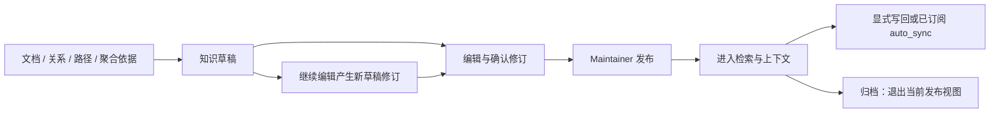

# 知识生命周期与外部来源

知识条目和 Wiki 都采用草稿、修订与明确发布流程。来源构建与权限前提见 [OPERATIONS.md](OPERATIONS.md) 和 [PRODUCT_OPERATIONS.md](PRODUCT_OPERATIONS.md)。

## 从依据到发布



Contributor 可提交草稿，Maintainer 发布。编辑草稿不会覆盖已有发布正文；发布指定 revision，防止覆盖并发改动。条目可记录 `applies_to`、`not_applies_to`。原文 ref、图关系/路径 ref 和 `summary_ref` 可作为同 KB 的类型化依据，随知识修订保存。

```bash
./bin/xrag knowledge list --profile team
./bin/xrag knowledge revisions ITEM_ID --profile team
./bin/xrag knowledge publish ITEM_ID --profile team --wait --revision DRAFT_REVISION
./bin/xrag knowledge archive ITEM_ID --profile team --confirm \
  --data '{"revision":"PUBLISHED_REVISION"}'
```

归档退出当前视图，允许的历史仍保留；明确撤回会阻止原引用及相关派生依据返回。知识修订历史最多 200 项，超限报错。远端 peer ref 当前不能直接作为本库长期发布依据。

## Wiki 生成与再生成

Wiki 需要该库的 Chat。固定资料视图，先按目录范围限制原始来源，再使用配置的词法、语义和图路线取材。最多 40 块、40,000 字符；排除 managed 知识与 Wiki，避免自引用。默认先大纲再正文，`single_pass=true` 时一次生成。

```bash
./bin/xrag wiki generate --profile team --wait \
  --data '{"topic":"日志","path":"manual/","single_pass":false}'
./bin/xrag wiki regenerate ITEM_ID --profile team --wait \
  --data '{"expected_revision":"CURRENT_DRAFT_REVISION","path":"manual/"}'
```

`path` 是库内前缀。生成结果保存为草稿；再生成创建同一条目的新修订，原发布版保持。任务启动时重新核对 expected_revision，失败不覆盖已有内容。格式检查要求合法的 `[n]` 引用，语义和结论仍需审核。

`[[主题]]` 在发布时解析为唯一已发布 Wiki 的 `links_to` 关系，标记 `origin=wiki`。歧义或未解析目标不强行连边；目标改名后需重建引用页。`+context` 可返回相关已发布 Wiki。

## 写回目录、Git 与 S3

先在 Server 端准备目标，再登记模板：

```bash
./bin/xrag sync-target add --profile team --confirm --data @examples/sync-target-path.json
./bin/xrag sync-target list --profile team
./bin/xrag knowledge sync ITEM_ID --profile team --confirm --wait \
  --data @examples/knowledge-sync.json
./bin/xrag knowledge sync-status ITEM_ID --profile team
```

先修改模板的 root、target_id 和 revision。目标 ID、路径、分支是固定绑定；地址变化需新目标。只允许同 KB 当前发布版本，单次最多 2 MiB，输出为 `prefix/KB/item_id.md`，附知识身份、修订和引用。

| 目标 | 行为与冲突处理 |
|---|---|
| path | 专用现存目录；内容摘要、目录锁与临时文件替换；外部编辑器不遵守锁时仍可能竞争 |
| Git | 本机仓库有初始提交，写 `xrag/*` 分支；独立临时 index、按旧 SHA 更新，保留工作区与原暂存区 |
| Git push | 需显式 `push=true` 和 remote_url，按已知远端 SHA 条件更新；没有通用 SSH 凭据助手 |
| S3 | SigV4、GET 与条件 PUT；首次 If-None-Match，更新 If-Match，服务不支持条件写入则失败 |

相同内容重复写回可幂等完成；目标被他人修改返回 `SYNC_CONFLICT`。回执只保留每目标每条目的最近成功版本。已送出的副本不会因后续撤回自动从外部删除。

目标设 `auto_sync=true` 后，后续发布成功会在事务中写 outbox，由 Worker 排写回任务。登记、编辑草稿不触发写回；失败保留已发布内容和失败任务，需显式重试。

构建器只有在目标位置、相对路径、规范内容摘要都匹配写回回执时才跳过副本。副本被外部修改后会作为普通来源处理。

## S3 兼容来源

参考 [source-s3.json](../examples/source-s3.json)，设置 path-style endpoint origin、region、bucket、prefix 和凭据引用：

```bash
./bin/xrag source add --profile team --data @examples/source-s3.json
./bin/xrag build run demo --profile team --wait
```

凭据需在 Server 和所有 Worker 环境中可解析，Client 不会传递本机环境变量。支持 session_token；`anonymous=true` 时不接受凭据字段。

实现 ListObjectsV2 完整分页、SigV4、If-Match 读取、ETag/长度检查与前后目录比较。支持 MD/Markdown/TXT，仍受单来源 5,000 文件、单文件 5 MiB、合计 64 MiB 限制。任一支持文件下载失败或分页异常时保留旧发布内容。

一致性标记 `object_conditional_live`；前后枚举可以发现可观察变化，不能冻结整个桶。当前没有自动 STS/IAM 角色获取和 virtual-host-only 适配。实际服务的条件写与版本差异需按 [联调指南](LIVE_INTEGRATION.md) 验证。

## WeKnora 解析文本来源

参考 [source-weknora.json](../examples/source-weknora.json)，root 为服务 origin，knowledge_base 为上游库 ID，api_key 为引用。默认用 X-API-Key，也可选 Authorization Bearer。

```bash
./bin/xrag source add --profile team --data @examples/source-weknora.json
./bin/xrag build run demo --profile team --wait
```

依赖的上游读取接口：

- `GET /api/v1/knowledge-bases/{id}/knowledge?page=...&page_size=100&sort_by=created_at&sort_order=asc`
- `GET /api/v1/chunks/{knowledge_id}?page=...&page_size=100&chunk_type=text`

按 `chunk_index + id` 排序导出 `<knowledge_id>.md`，保留分块边界与重叠。导入的是上游解析文本，原 PDF、图片或表格布局不随之还原。

文档未 completed、分页失配、块下载失败会保留旧来源；disabled 文档跳过。一致性标记 `upstream_live_export`，依赖上游文档更新时间可观察到的变化。XRAG peer 实时搜索是另一种配置，见 [CONNECTIONS.md](CONNECTIONS.md)。

## 文档处理与图抽取

默认轻量解析器处理文本；可按库选择已登记的 CommonMark/YAML 插件、领域词典与字段类型。YAML 插件拒绝 aliases、重复键和非字符串键。NFC 规范化与来源摘要分别处理，未变化来源不会仅因输入规范化而反复重建。

图来源可以是显式 `[[A]] --使用--> [[B]]`、配置的 LLM，或 JSONL 抽取插件。include/exclude 限定图路径，实体/关系类型可进一步约束。LLM evidence 的原文子串检查确认出处存在，实体同名消歧与语义正确性仍需业务核对。配置入口见 [连接说明](CONNECTIONS.md)。
