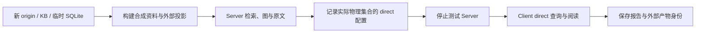

# 专业后端与模型联调

本页提供可复现的联调路线。脚本存在和受控协议测试的结果记在 [STATUS.md](STATUS.md)；实际服务的版本、网络、数据与模型效果需要在选定环境执行并保留报告。

## 准备专用服务

需要 Qdrant、支持 Query API v2 的 Neo4j 和 Embedding 服务。使用专用测试命名空间，模型调用可能产生费用。可用 [compose.backends.yaml](../deploy/compose.backends.yaml) 启动数据库：

```bash
# 填写已选定的真实版本或 digest；不要把占位值直接执行
export QDRANT_IMAGE='qdrant/qdrant:SELECTED_VERSION'
export NEO4J_IMAGE='neo4j:SELECTED_VERSION'
# 在当前环境另行准备 QDRANT_API_KEY 和 NEO4J_PASSWORD
# 以下命令会拉取镜像、启动容器并创建测试存储
docker compose -f deploy/compose.backends.yaml up -d
```

Compose 只启动外部数据库，端口绑定 localhost。XRAG 进程仍按自己的构建/启动步骤运行。Neo4j 适配使用 HTTP 7474 Query API，不使用 Bolt URL。

## 联调脚本

复制 [providers.live.json](../examples/providers.live.json)，填实际地址、模型、维度、修订和 env/file 引用：

```bash
make build
python3 scripts/live_backends.py \
  --config /absolute/path/real.providers.json \
  --report /absolute/path/live-report.json \
  --confirm-services
```

不带 `--confirm-services` 时写 not_run 报告并退出 2，不发外部请求。带确认后，脚本建立临时目录、新 origin 和随机 KB，调用模型并写入外部测试数据。



该脚本覆盖连接、身份、发布与直连流程。业务效果还需自建题集、代表性语料、相关性标注和成本测量；两份合成资料不足以估算业务质量。

direct 使用的物理集合从 Qdrant `xrag_demo_meta` descriptor 读取，并核对本次 origin、KB、模型身份、名称和维度。脚本使用随机 KB；若匹配到零个或多个 descriptor，会停止验证并保留报告，不根据集合名称猜测绑定。读取 descriptor 沿用配置中的 Qdrant `env:` / `file:` 凭据引用。

## 记录与清理

报告应保留：程序 commit、后端版本、模型标识/修订、步骤结果、origin、KB、physical_collection、请求错误和实际费用。共享报告前检查凭据与业务正文是否需要脱敏。

脚本保留外部测试产物方便排查，不自动跨库删除。只清理报告中的本次 origin/集合；`xrag_demo_meta` 可能保存其他库描述，不应整集合删除。Neo4j 也需按本次 authority 限定。

验证恢复时，从同次 SQLite 快照建立新的恢复副本和独立目标，按 [DATA_RECOVERY.md](DATA_RECOVERY.md) 核对固定引用、向量与图。仅地址可连接不足以确认它与快照对应。

## 其他外部服务

| 服务 | 建议的最小实际检查 |
|---|---|
| S3/MinIO | 分页枚举、带 ETag 读取、更新与删除、失败保留旧发布、条件 PUT 冲突 |
| WeKnora | 当前部署的知识/块接口、completed/disabled、分页数量、文本顺序与变更 |
| Chat / Rerank | 实际响应格式、用量、预算、错误、Wiki/Research 依据与结论 |
| 视觉 Chat | 图片格式/大小、可读文字、模糊内容；先阅读 [当前限制](IMAGE_DESCRIBE.md) |
| Git Hook | 真实厂商经 HTTPS 入口投递、仓库/ref 匹配、重复 ID、Worker 最终构建 |
| MCP / IdP | 实际 Agent 的发现/调用、introspection、scope/KB 交集、过期/取消 |

规范入口：[Qdrant 文档](https://qdrant.tech/documentation/)、[Neo4j Query API](https://neo4j.com/docs/query-api/current/query/)、[MCP 2025-11-25](https://modelcontextprotocol.io/specification/2025-11-25)。这些描述外部合同，具体部署结果以本次报告为准。
