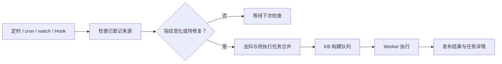
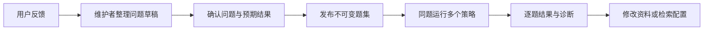

# 来源、构建与效果比较

本指南使用当前 Server 与 `team` profile。首次启动见 [README](../README.md)，模型和后端见 [连接配置](CONNECTIONS.md)。操作来源、构建、评测需 Maintainer 或 Admin。

## 准备资料

工作台“资料与来源”可上传 MD/Markdown/TXT、登记来源并查看已发布文件。远程上传传文件内容；登记 `root` 则指 Server/Worker 所在机器能读取的位置。

```bash
./bin/xrag source upload ./examples/docs/02-errors.md --profile team
./bin/xrag source add --profile team --id handbook \
  --kind path --root /absolute/path/to/notes --mount handbook
./bin/xrag source add --profile team --id project \
  --kind git --root /absolute/path/to/repository --git-ref main --mount project
./bin/xrag source list --profile team
./bin/xrag build run demo --profile team --mode incremental --wait
```

示例默认操作 `demo`。创建独立库可用 `./bin/xrag kb create handbook --name 使用手册 --profile team`；随后为来源命令加 `--kb handbook`，构建使用 `build run handbook`，或另建默认库为 handbook 的 profile。

来源的 kind/root/mount 是固定绑定；编辑可调整 include/exclude/disabled，改变地址或挂载需新 ID。停用停止扫描和 Hook，保留已发布内容；移除来源退出当前查询视图，允许保留的旧引用仍可阅读。

## 目录与 Git 的读取方式

| 来源 | 读取语义 |
|---|---|
| path / builtin | 完整枚举支持的文件并读取；普通目录没有瞬时快照 |
| 本机 Git | 将 branch/tag/SHA 固定为 commit，读取该提交的树与 blob |
| 公共 HTTPS Git | 使用独立 mirror cache，禁用交互登录；URL 不携带用户、密码或 query |
| S3 / WeKnora | 受限接口的完整分页与一致性检查，见 [外部来源](LIFECYCLE_AND_SOURCES.md) |

Git 不 checkout，不读取未提交修改，不执行仓库 hooks，不展开子模块或符号链接；Git LFS 和私有 SSH/凭据助手未集成。私有仓可由管理员在 Server 机器准备本机副本，再登记路径。

每个 Server 来源最多 5,000 个支持文件、单文件 5 MiB、合计正文 64 MiB。超限、读取失败或 Git ref 不存在时保留该来源旧发布内容。较大语料可拆为多个来源在同一 KB 构建。local Client 的扫描限额另见 [连接说明](CONNECTIONS.md)。

## 构建模式

| 模式 | 读取对象 | 适用场景 |
|---|---|---|
| `incremental` | 当前来源、内容与配置差异 | 日常更新、补齐失败的 optional 投影 |
| `full` | 当前全部来源 | 重新解析并物化所有支持文件；有效模型缓存可复用 |
| `vectors_only` | 已发布原文与块 | 更换向量配置或生成新的词法/向量集合；不扫描来源 |
| `graph_only` | 已发布内容 | 更新图范围/抽取器；复用已有向量 |

```bash
./bin/xrag build run demo --profile team --mode vectors_only --wait
./bin/xrag build run demo --profile team --mode graph_only --wait
./bin/xrag jobs list --profile team
./bin/xrag jobs details JOB_ID --profile team
./bin/xrag jobs cancel JOB_ID --profile team
```

构建按 KB 互斥；触发来源通知后构建的是整个 KB。配置模型后，这些操作可能产生外部调用。`--wait` 超时只结束客户端等待，需另行取消后台任务。详情包含文件结果、edition、Git commit、触发原因与用量；最多 1,000 项文件详情和 100 条触发记录。

## 持续更新



来源策略默认关闭。保存策略后，Server 负责检查与入队，Worker 负责执行；只有 Worker 的进程不运行来源检查器。API-only Server 也可继续排队。

```bash
./bin/xrag source policy --profile team --id handbook \
  --data '{"every_seconds":0,"watch_seconds":5,"debounce_seconds":10}'
./bin/xrag source policy --profile team --id project \
  --data '{"every_seconds":60,"watch_seconds":0,"debounce_seconds":10}'
```

`every_seconds` 为 0 或 10–604800；`watch_seconds` 为 0 或 2–3600，只用于 path/builtin；debounce 为 1–300，0/省略采用 10 秒。文件指纹轮询会读取内容，频率越高 I/O 越多。

还可配置五字段 cron 与 IANA 时区、原生 watch。cron 接受数字列表、范围和步长；Linux watch 使用 inotify，其他平台与网络挂载依赖周期兜底。完整字段见 [source-policy.schema.json](../contracts/management/source-policy.schema.json)。旧 `--scan-every` 会定期直接排库构建，避免与来源策略重复使用。

关闭策略需把定时/watch/cron 等实际启用项关闭；清空 `hook_secret_ref` 关闭 Hook。已有任务须单独取消。

### Git 推送与自定义 Hook

入口为 `POST /v1/hooks/{kb}/{source}`。GitHub/GitLab/Gitea 仅对 Git 来源使用，显式设置 provider、精确仓库名、ref 和 Server 可解析的密钥引用：

```bash
./bin/xrag source policy --profile team --id project \
  --data @examples/source-policy-github.json
```

| provider | 验证方式 |
|---|---|
| github | 原始 body HMAC-SHA256；`X-Hub-Signature-256`；delivery ID 去重 |
| gitlab | `X-Gitlab-Token`；事件类型一致性；Idempotency-Key 或 Webhook UUID 去重 |
| gitea | 原始 body HMAC-SHA256；无前缀 hex 签名；delivery ID 去重 |
| custom | XRAG 时间戳、事件 ID、HMAC-SHA256 协议 |

通知只安排重新读取已登记来源，消息中的 URL/文件列表不能替换来源配置。相同交付 ID 与相同 body 返回原任务；复用 ID 改内容会冲突。202 表示已接受通知，随后检查任务结果。

自定义 Hook 以 `timestamp + "\n" + event + "\n" + body` 签名，允许前后 300 秒，body 最大 64 KiB，密钥至少 32 字符。发送示例见 [send_hook.py](../scripts/send_hook.py)，原生通知细节保留在 [Demo.7 历史记录](DEMO7_OPERATIONS.md)。

## 同题比较与反馈

```bash
./bin/xrag eval import --profile team --data @examples/eval-demo.json
./bin/xrag eval list --profile team
./bin/xrag eval run SET_ID --profile team --wait --timeout 10m \
  --data '{"strategies":["keyword","ask","ask_graph"],"k":5}'
./bin/xrag eval report JOB_ID --profile team
```

题集最多 100 题、5 个策略，k 为 1–50，默认 5。支持 keyword、semantic、ask、ask_graph、ask_rerank；模型策略需对应配置。正例有 expected 路径及可选 anchor，负例显式 `expected_empty=true`。运行前检查路径和锚点，失效返回 `EVAL_DATASET_INVALID`。

一次任务使用固定文件版视图，阻止同 KB 构建/知识发布并行。其他库的 FTS 词频和外部模型仍可能变化，精细比较应控制这些变量。Hit@K、Recall@K、MRR 按正例计算，负例单独统计；错误计入分母并使任务 partial。p50/p95 是本次题集耗时。评测模型调用纳入任务预算记录。



反馈不会自动成为真值。可用 `feedback test-case`、`eval drafts`、`eval approve`、`eval from-drafts`，对应模板见 [examples/](../examples/)。同 family 的 development/holdout 集合检查规范化问题的字面重复；当前没有语义去重或强制盲评。
