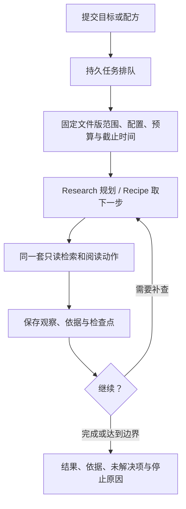
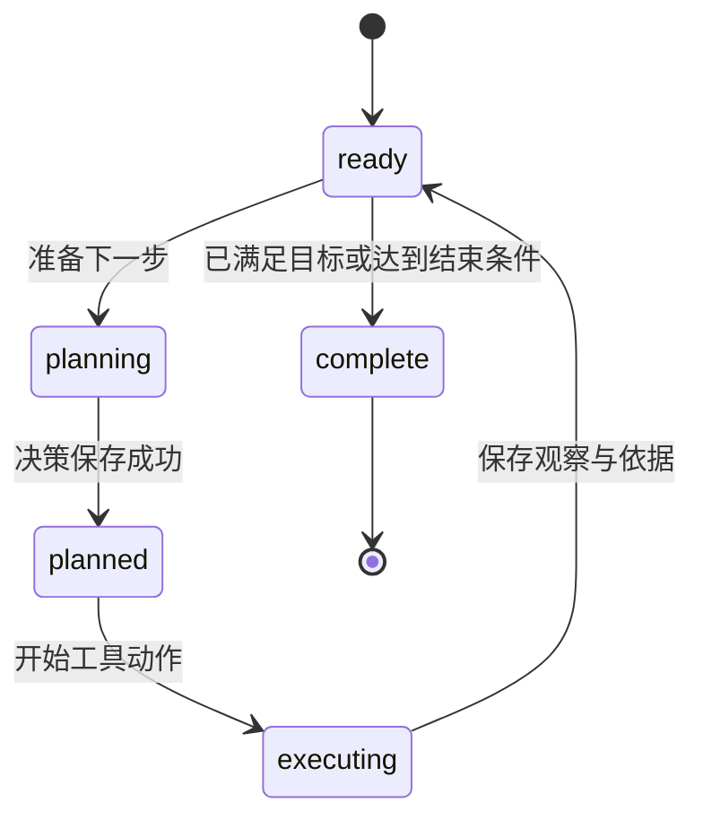

# Research 与 Recipe

Research 在固定资料范围内由 Chat 模型选择下一步读取动作；Recipe 顺序执行明确的只读步骤。两者都在 Server 上持久排队。`+ask` 是一次固定检索组合，适合取得候选资料；多步调查使用这里的任务入口。

## 提交与查看

```bash
# Research 需要目标 KB 配置 Chat
./bin/xrag research run --profile team --data @examples/research-task.json --wait
# Recipe 的示例只有关键词和阅读，不需模型
./bin/xrag recipe run --profile team --data @examples/recipe-run.json --wait
./bin/xrag jobs show JOB_ID --profile team
./bin/xrag jobs watch JOB_ID --profile team --timeout 10m
./bin/xrag jobs cancel JOB_ID --profile team
```

Research 输入为 `kb`、`goal`，以及可选的库内 `path`、`max_steps`、`max_seconds`。默认 8 步/120 秒，上限 16 步/600 秒。排队期限 24 小时；首次领取时固定执行截止时间。Reader 可在可见 KB 提交任务，任务状态/取消/续跑受 owner 或 Maintainer 范围检查。

`--wait` 或 `watch` 结束不自动取消后台任务。没有 Worker 时任务保持排队。需要扩大范围、增加预算或改变模型时，提交新的任务。



允许搜索、原文、图、上下文等已公布动作，不能执行 Shell、任意 SQL、业务写操作或递归 Agent。每次工具结果、调查上下文和重复动作都有边界。Recipe 选用 semantic/rerank 等步骤时仍会调用相关模型。

## 依据与数字

文档结论通过实际 Read 登记依据，图路径/关系可登记结构化依据，精确完整的关键词/grep 统计可登记 aggregate。模型只能引用任务已登记的依据 ID。

数值结论使用绑定的 `{n}`，由程序读取 exact 且计算完整的 total，按其单位渲染。文本命中数的单位仍是文件、块、匹配或关系。模型对否定、条件、关系和因果的解释需要阅读者核对。

成功或带明确缺口的结果保留引用至少 7 天，返回 `references_expire_at`。普通更新保留可读历史；来源明确撤回会使相关任务正文与依据停止返回。

## 检查点与续跑



检查点记录输入、固定范围、首次开始时间、观察、依据、下一步与预算关联。续跑仍使用原 ID/run_id，增加 attempt，不重置资料范围、已用预算或截止时间：

```bash
./bin/xrag research resume JOB_ID --profile team --wait
./bin/xrag recipe resume JOB_ID --profile team --wait
```

| 保存阶段 | 续跑处理 |
|---|---|
| ready | 从已保存观察继续 |
| planned | 复用已存决策 |
| executing 的本地确定只读动作 | 在仍有效的固定范围重跑，如 keyword、grep、read、discover |
| planning 的 Recipe | 重算固定下一步 |
| planning 的 Research | 规划调用结果未知，拒绝重放 |
| executing 的可能收费/实时动作 | 未知结果不重放，返回明确错误 |
| complete | 复用最终结果并完成任务收尾 |

仅失败或租约过期的中断任务可继续；用户取消、到期、配置变化、来源撤回、缺少检查点或原租约仍有效等条件会拒绝。`RESUME_OUTCOME_UNKNOWN` 表示调用结果未保存，不能确认是否已经收费。继续操作失败不会自动创建新任务。

## Recipe 格式

[recipe-run.json](../examples/recipe-run.json) 给出可直接使用的请求。配方格式 `xrag.recipe/v1`，含 1–15 个顺序步骤：

```json
{
  "version": "xrag.recipe/v1",
  "name": "keyword-then-read",
  "steps": [
    {"action":"search.keyword","arguments":{"q":"$input","limit":3}},
    {"action":"files.read","arguments":{"ref":"$last.ref","length":3000}}
  ]
}
```

`$input` 为任务 goal，`$last.ref` 为上一结果第一项引用；没有上一引用时失败。配方没有循环、分支或任意表达式。输出包含实际步骤与依据，`stop_reason=recipe_completed`。

CLI 可用 `--recipe examples/recipe.yaml` 读取 YAML，转换需要 Python3/PyYAML；服务器只收 JSON。JSON 示例不需要 YAML 依赖。

## 任务状态流

`GET /v1/tasks/events?id=...` 每半秒观察持久状态，返回 task、done、error 或 reconnect 事件。单次订阅最多十分钟，重连后取得当前快照；没有历史事件重放或逐 Token 输出。

工作台“调查”可查看实时状态与继续按钮。离开页面、隐藏页面或退出会停止订阅。订阅等待不持有内容共享租约，后台任务仍按自身生命周期运行。MCP 对应 research 工具组，见 [接入说明](API_MCP.md)。

模型规划和工具中的模型调用共用任务预算；未知结果保留预留。预算语义见 [日常管理](PRODUCT_OPERATIONS.md) 和 [状态](STATUS.md)。
