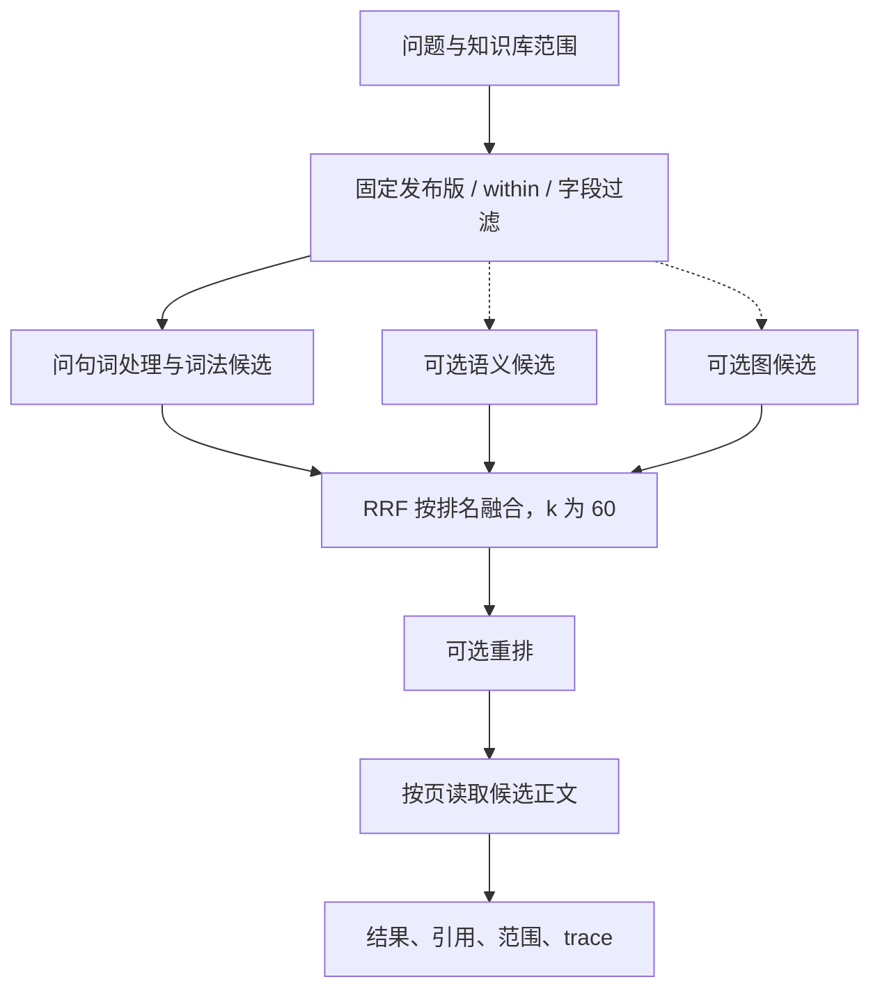
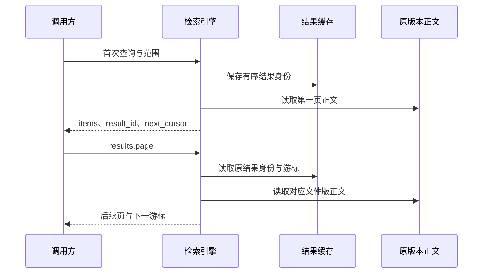

# 检索、范围与引用

先用 `kb discover` 查看当前资料与能力。以下命令假定已按 [README](../README.md) 保存 `team` profile，默认知识库为 `demo`。

## 按问题选择动作

| 目的 | 动作 | 返回含义 |
|---|---|---|
| 找编号、关键词并统计 | `search.keyword` | 严格匹配；Server/local 可计算匹配块数 |
| 用自然语言找资料 | `+ask` | 宽松词法候选，可组合语义、图、重排与外部检索 |
| 按含义找相近内容 | `search.semantic` | 需要 Embedding；Top K 候选 |
| 核对原文或正则匹配 | `files.read` / `files.grep` | 固定版本阅读 / RE2 文本匹配 |
| 查实体的邻居或路径 | `graph.entity` / `graph.neighbors` / `graph.path` | 带来源支撑的实体与有向关系 |
| 汇集实体上下文 | `+context` | 实体、关系、出处及相关已发布 Wiki |
| 多步取证并形成结论 | [Research](RESEARCH.md) | 有界任务、依据和未解决项 |

```bash
./bin/xrag kb discover --profile team
./bin/xrag search keyword E203 --profile team --trace
./bin/xrag +ask "日志丢失怎么排查" --profile team --trace
./bin/xrag search semantic "日志丢失" --profile team
./bin/xrag graph neighbors --name 设备A --profile team
./bin/xrag graph path --from 设备A --to 日志事件 --profile team
```

`+ask` 返回检索结果。关闭模型时也可使用词法路线；开启语义、重排等能力会调用配置的服务。实际采用的路线、候选数与回退原因以响应 `strategy`、`notes` 和 `trace` 为准。

## keyword 与 ask 的词法差异

| 模式 | `search.keyword` | `+ask` 词法路线 |
|---|---|---|
| Server | SQLite FTS5 严格匹配与 BM25 排序；支持中文回退规则 | 剥离问句词，以 OR 召回并按 BM25 排序 |
| local | 本机 MD/TXT 的严格文本扫描与启发式排序 | 共用问句词处理，OR 召回、BM25，最多 500 个词法候选 |
| direct | Qdrant payload 文本过滤，排序及总数能力有限 | 新集合的 `xrag_terms` 稀疏向量与 Qdrant IDF 提供 BM25 词法排序 |

问句词处理最多使用 48 个查询词元。Server/direct 的组合路线保留有界候选；重排前最多装配 200 个候选正文。direct 稀疏词法使用固定平均块长度常数，效果需用自己的语料评估。旧集合回退到文本过滤，并返回“集合缺少稀疏词法索引，需要重建”，升级步骤见 [连接说明](CONNECTIONS.md)。



各路线分数通过排名融合，不能直接比较 BM25 与向量分数。外部 XRAG peer 是另一个需显式配置的实时来源；它的结果保留远端身份与绑定信息。

## 阅读原文

```bash
# path 指当前发布文件，需明确 KB
./bin/xrag files read --path manual/02-errors.md --kb demo --profile team
# REF 换成检索返回的完整 ref
./bin/xrag files read --ref REF --profile team
# 读取指定字符段
./bin/xrag files read --ref REF --profile team \
  --data '{"offset":0,"length":3000}'
```

`ref` 固定原文件版；普通更新后可继续读尚保留的旧版。字符区间按规范化文本的 Unicode code point 计算。查看 `content_truncated` 和区间后再继续阅读。明确撤回会使旧引用失效；已被清理的版本可能返回 `REF_GONE`。

`files.grep` 按完整原文执行 RE2 匹配，可跨分块；不把不连续的 `within` 区间拼成一段文本：

```bash
./bin/xrag files grep --profile team --data '{"pattern":"E20[0-9]"}'
```

## 范围与分页

先列文件并申请范围，随后把返回的 handle 作为 `within`：

```bash
./bin/xrag files tree --profile team --data '{"save_scope":"required"}'
./bin/xrag search keyword E203 --profile team --within HANDLE
./bin/xrag handle show HANDLE --profile team
```

`within` 绑定文件版本/片段范围，后续过滤继续缩小它。`scope.expand` 才会显式扩大到相关实体提及块，并继续应用请求 filters。`files.tree` 的 handle 是否完整取决于整个结果是否能装入缓存窗口。



```bash
./bin/xrag results page --profile team \
  --data '{"result_id":"RESULT_ID","cursor":"NEXT_CURSOR","limit":20}'
```

保存窗口默认最多 20,000 项。超出窗口时 `cache_complete=false`；要求完整 handle 会报 `HANDLE_TOO_LARGE`，应收窄范围。分页不会重新搜索或再次调用重排模型。句柄与结果还受身份、到期和撤回检查约束。

## 怎样理解数量与完整性

| 字段 | 需要检查什么 |
|---|---|
| `returned` | 本次返回的条目数 |
| `total.value / unit` | 匹配块、文件、匹配次数或关系；按动作读取单位 |
| `total.accuracy / calculation_complete` | 是否精确、计算是否完成；Top K 通常没有全集总数 |
| `coverage.execution_partial` | 是否存在执行失败或未完成路线 |
| `coverage.display_truncated` | 当前展示是否被条数/字符上限截断 |
| `coverage.approximate` | 是否涉及近似召回 |
| `cache_complete` | 可翻页的缓存窗口是否保存了完整结果 |

`keyword` 的 `total` 单位是 chunks，`grep` 是 matches，图邻居是 relations；`support_count` 单独表示支撑数量。业务上的客户数、事件数需要业务字段与统计定义，不能由文本命中数直接推得。`per_file` 限制展示选择，不改变原查询总量。

## 性能与定位问题

Server 的无 `within` keyword/tree 使用索引和元数据，复杂检索使用 compact 元数据视图，正文按页补取。SQLite 语义路线逐向量做精确余弦扫描，仍为 O(N)；图遍历上限为 5 层、5,000 个前沿实体、20,000 个支撑。完整 View、grep 与复杂 direct 仍有装载上限。

```bash
./bin/xrag trace list --profile team
./bin/xrag trace show QUERY_ID --profile team
./bin/xrag trace diagnose QUERY_ID --profile team \
  --data @examples/query-diagnose.json
```

诊断读取已保存 trace 和指定文件的当前状态，不重新检索。历史未保存的候选会显示 unknown。效果比较和大语料基线见 [来源与构建](OPERATIONS.md) 与 [开发指南](DEVELOPMENT.md)。
